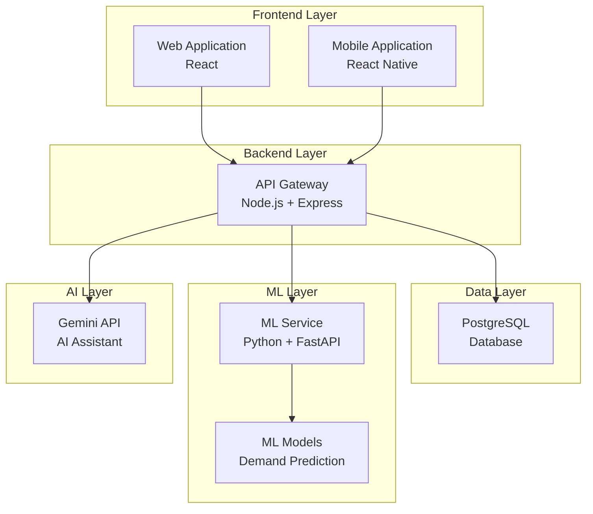

# System Architecture

## Overview

The Smart Inventory & Warehouse Management System follows a microservices architecture with clear separation of concerns.

## High-Level Architecture



## Component Details

### 1. Frontend Layer

#### Web Application (React)
- **Purpose**: Admin and management interface
- **Technology**: React + Vite
- **Users**: Managers, administrators, analysts
- **Features**:
  - Dashboard and analytics
  - Product management
  - Inventory tracking
  - Report generation
  - AI assistant interface

#### Mobile Application (React Native)
- **Purpose**: Warehouse operations interface
- **Technology**: React Native + Expo
- **Users**: Warehouse workers
- **Features**:
  - Barcode/QR scanning
  - Stock operations (in/out/transfer)
  - Real-time inventory updates
  - Offline support

### 2. Backend Layer

#### API Gateway (Node.js + Express)
- **Purpose**: Central API server
- **Responsibilities**:
  - Request routing
  - Authentication & authorization
  - Business logic
  - Data validation
  - Integration with other services
- **API Design**: RESTful
- **Authentication**: JWT tokens

### 3. Data Layer

#### PostgreSQL Database
- **Purpose**: Primary data store
- **Data**:
  - Products and categories
  - Inventory and warehouses
  - Stock movements
  - Orders and suppliers
  - Users and permissions
  - Predictions cache

### 4. ML Layer

#### ML Service (Python + FastAPI)
- **Purpose**: Machine learning predictions
- **Responsibilities**:
  - Demand forecasting
  - Stock risk assessment
  - Restock recommendations
  - Model training and updates
- **Models**:
  - Time series forecasting (ARIMA, Prophet)
  - Classification (Risk levels)
  - Optimization (Restock quantities)

### 5. AI Layer

#### Gemini AI Integration
- **Purpose**: Natural language assistant
- **Responsibilities**:
  - Answer inventory queries
  - Provide insights
  - Explain predictions
  - Generate recommendations
- **Integration**: API calls from backend only

## Data Flow

### Product Lookup Flow

```
User → Web/Mobile → API Gateway → Database → Response
```

### Demand Prediction Flow

```
API Gateway → ML Service → Load Model → Generate Prediction → 
Cache in Database → Return to API Gateway → Response to Client
```

### AI Assistant Flow

```
User Query → API Gateway → Retrieve Context from Database → 
Format Prompt → Gemini API → Process Response → Return to Client
```

### Stock Movement Flow

```
Mobile App → Scan Barcode → API Gateway → Validate Product → 
Update Inventory in Database → Record Movement → 
Trigger Prediction Update → Sync Response
```

## Security Architecture

### Authentication Flow

```
User Login → Backend → Validate Credentials → Generate JWT → 
Return Token → Client Stores Token → Include in All Requests
```

### Authorization Levels

1. **Admin**
   - Full system access
   - User management
   - Configuration

2. **Manager**
   - View all data
   - Manage products
   - Generate reports

3. **Worker**
   - Stock operations only
   - Limited viewing
   - Mobile app access

### Security Measures

- Password hashing (bcrypt)
- JWT token authentication
- HTTPS only
- Input validation
- SQL injection prevention (parameterized queries)
- Rate limiting
- CORS configuration
- API key protection (server-side only)

## Scalability Considerations

### Horizontal Scaling

- **Backend**: Multiple instances behind load balancer
- **ML Service**: Separate instances for training vs. inference
- **Database**: Read replicas for query distribution

### Caching Strategy

- **Redis Cache** (future):
  - Prediction results
  - Frequently accessed products
  - User sessions
  - API responses

### Performance Optimization

- Database indexing
- Pagination for large datasets
- Lazy loading in frontend
- Image optimization
- API response compression
- Query optimization

## Monitoring & Logging

### Logging Strategy
- Application logs (Winston/Bunyan)
- Access logs
- Error logs
- ML model performance logs

### Monitoring (Future)
- API response times
- Database query performance
- ML service latency
- Error rates
- User activity

## Deployment Architecture (Future)

```
GitHub → CI/CD Pipeline → Testing → Build → 
Deploy to Production (Docker + Cloud)
```

### Environments

1. **Development**: Local development
2. **Staging**: Pre-production testing
3. **Production**: Live system

## Technology Decisions

### Why React?
- Component reusability
- Large ecosystem
- Easy to learn
- Great developer tools

### Why Node.js?
- JavaScript across stack
- Fast I/O operations
- Large package ecosystem
- Good for API development

### Why PostgreSQL?
- ACID compliance
- Complex queries support
- JSON support
- Mature and reliable

### Why Python for ML?
- Best ML ecosystem
- scikit-learn, pandas, numpy
- Easy model development
- FastAPI for quick API development

### Why FastAPI?
- Fast performance
- Automatic API documentation
- Type hints
- Async support

## Future Enhancements

- Real-time notifications (WebSocket)
- Advanced analytics dashboard
- Multi-tenant support
- Mobile offline sync improvements
- Advanced ML models
- Automated reordering
- Supplier integration APIs
- IoT sensor integration

## Current Status

- ✅ Phase 1: Frontend architecture implemented
- 🔄 Phase 2: Backend architecture (planned)
- 🔄 Phase 3: ML architecture (planned)
- 🔄 Phase 4: AI integration (planned)
- 🔄 Phase 5: Mobile architecture (planned)
